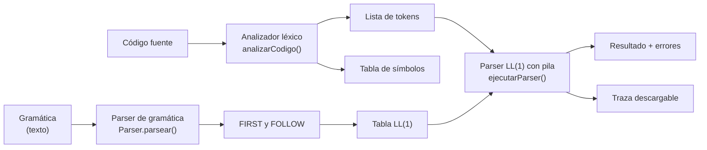

# Analizador Léxico y Sintáctico LL(1)

Aplicación web, sin dependencias, que analiza código fuente escrito en un pequeño lenguaje tipo Pascal. Todo el procesamiento ocurre en el navegador con HTML, CSS y JavaScript puro.

A partir del código que escribe el usuario, la aplicación:

1. **Tokeniza** el texto (análisis léxico) y genera la **lista de tokens** y la **tabla de símbolos**.
2. **Calcula los conjuntos FIRST y FOLLOW** de una gramática y construye la **tabla sintáctica LL(1)**.
3. **Ejecuta un parser predictivo descendente no recursivo** (basado en pila) guiado por esa tabla.
4. Detecta **errores léxicos, sintácticos y semánticos** (identificadores duplicados).
5. Permite **descargar la traza completa** del análisis en `traza_analisis.txt`.

---

## Tabla de contenido

- [Estructura del proyecto](#estructura-del-proyecto)
- [Cómo ejecutarlo](#cómo-ejecutarlo)
- [Flujo general](#flujo-general)
- [El lenguaje que reconoce](#el-lenguaje-que-reconoce)
- [Gramática](#gramática)
- [Explicación detallada del código](#explicación-detallada-del-código)
  - [`firstFollow.js`](#firstfollowjs-motor-de-gramáticas)
  - [`app.js`](#appjs-lexer-parser-e-interfaz)
  - [`index.html`](#indexhtml)
  - [`styles.css`](#stylescss)
- [Manejo de errores](#manejo-de-errores)
- [Ejemplo de traza](#ejemplo-de-traza)
- [Cómo modificar la gramática](#cómo-modificar-la-gramática)
- [Limitaciones conocidas y posibles mejoras](#limitaciones-conocidas-y-posibles-mejoras)

---

## Estructura del proyecto

```
Parser/
└── src/
    ├── index.html      # Interfaz: entrada de código y tablas de resultados
    ├── styles.css      # Estilos (tema oscuro, diseño en dos columnas, responsive)
    ├── firstFollow.js  # Motor de gramáticas: FIRST, FOLLOW y tabla LL(1)
    └── app.js          # Analizador léxico, parser LL(1) y lógica de la interfaz
```

## Cómo ejecutarlo

No requiere instalación, compilación ni servidor. Basta con abrir el archivo `src/index.html` en cualquier navegador moderno.

1. Escribe o pega código en el área de texto.
2. Pulsa **Analizar**.
3. Revisa las tablas y el resultado del parser. Si quieres, pulsa **Descargar traza_analisis.txt**.

> El área de texto captura la tecla `Tab` e inserta dos espacios en lugar de cambiar el foco.

---

## Flujo general



Al pulsar **Analizar**, el manejador del botón ejecuta estos pasos en orden:

1. `analizarCodigo(texto)` convierte el código en tokens y tabla de símbolos.
2. Se rellenan las tablas de **tokens** y de **símbolos** en la página.
3. `calcularGramaticaEstructurada(gramatica)` calcula FIRST, FOLLOW y la tabla LL(1).
4. Se dibuja la **tabla sintáctica LL(1)** (columnas = terminales, filas = no terminales).
5. `ejecutarParser(tokens, tabla, terminales)` analiza la secuencia de tokens.
6. Se muestra el resultado (verde si es exitoso, rojo si hay error) y se habilita el botón de descarga.

---

## El lenguaje que reconoce

### Ejemplo de programa válido

```pascal
program Calculadora;
var
  a : int;
  b : float;
begin
  a = 5 + b;      // los comentarios empiezan con //
  b = a + 2.5;
end
```

### Tokens

| Categoría | Lexema | Token |
|---|---|---|
| Palabras reservadas | `program` `var` `int` `float` `begin` `end` | `PROGRAM` `VAR` `INT` `FLOAT` `BEGIN` `END` |
| Delimitadores | `;` `:` `(` `)` | `SEMICOLON` `COLON` `LPAREN` `RPAREN` |
| Operadores | `=` `+` `*` | `ASSIGN` `PLUS` `MULT` |
| Identificadores | letra seguida de letras, dígitos o `_` | `ID` |
| Números | dígitos y puntos (`5`, `2.5`) | `NUM` |
| Cualquier otro carácter | `@`, `#`, `$`... | `ERROR_LEXICO` |

Reglas adicionales del análisis léxico:

- Los **espacios**, **tabuladores** y retornos de carro (`\r`) se ignoran. Cada salto de línea (`\n`) incrementa el contador de líneas.
- Los **comentarios** `// ...` se descartan hasta el final de la línea.
- Las **palabras reservadas no distinguen mayúsculas de minúsculas** (`BEGIN`, `Begin` y `begin` son el mismo token), pero el lexema conserva su escritura original.
- Los **identificadores** sí distinguen mayúsculas (`a` y `A` son distintos).

---

## Gramática

La gramática está definida como texto dentro de `app.js` y es **LL(1) sin conflictos**:

```
P       -> PROGRAM ID SEMICOLON D B
D       -> VAR L | EPS
L       -> ID COLON T SEMICOLON L_PRIMA
L_PRIMA -> L | EPS
T       -> INT | FLOAT
B       -> BEGIN S END
S       -> ID ASSIGN E SEMICOLON S_PRIMA
S_PRIMA -> S | EPS
E       -> F E_PRIMA
E_PRIMA -> PLUS F E_PRIMA | EPS
F       -> ID | NUM
```

`P` es el símbolo inicial, `EPS` representa la cadena vacía (ε) y `$` marca el fin de la entrada. Los nombres `L_PRIMA`, `S_PRIMA` y `E_PRIMA` son las versiones sin recursión por la izquierda de las listas de declaraciones, sentencias y expresiones.

### Conjuntos FIRST y FOLLOW

| No terminal | FIRST | FOLLOW |
|---|---|---|
| `P` | `PROGRAM` | `$` |
| `D` | `VAR`, `EPS` | `BEGIN` |
| `L` | `ID` | `BEGIN` |
| `L_PRIMA` | `ID`, `EPS` | `BEGIN` |
| `T` | `INT`, `FLOAT` | `SEMICOLON` |
| `B` | `BEGIN` | `$` |
| `S` | `ID` | `END` |
| `S_PRIMA` | `ID`, `EPS` | `END` |
| `E` | `ID`, `NUM` | `SEMICOLON` |
| `E_PRIMA` | `PLUS`, `EPS` | `SEMICOLON` |
| `F` | `ID`, `NUM` | `PLUS`, `SEMICOLON` |

### Tabla sintáctica LL(1)

Cada fila indica qué producción se aplica cuando el no terminal está en la cima de la pila y el token actual es el terminal indicado. Cualquier combinación que no aparezca aquí es una celda vacía y provoca un error sintáctico.

| No terminal | Terminal | Producción |
|---|---|---|
| `P` | `PROGRAM` | `P -> PROGRAM ID SEMICOLON D B` |
| `D` | `VAR` | `D -> VAR L` |
| `D` | `BEGIN` | `D -> EPS` |
| `L` | `ID` | `L -> ID COLON T SEMICOLON L_PRIMA` |
| `L_PRIMA` | `ID` | `L_PRIMA -> L` |
| `L_PRIMA` | `BEGIN` | `L_PRIMA -> EPS` |
| `T` | `INT` | `T -> INT` |
| `T` | `FLOAT` | `T -> FLOAT` |
| `B` | `BEGIN` | `B -> BEGIN S END` |
| `S` | `ID` | `S -> ID ASSIGN E SEMICOLON S_PRIMA` |
| `S_PRIMA` | `ID` | `S_PRIMA -> S` |
| `S_PRIMA` | `END` | `S_PRIMA -> EPS` |
| `E` | `ID`, `NUM` | `E -> F E_PRIMA` |
| `E_PRIMA` | `PLUS` | `E_PRIMA -> PLUS F E_PRIMA` |
| `E_PRIMA` | `SEMICOLON` | `E_PRIMA -> EPS` |
| `F` | `ID` | `F -> ID` |
| `F` | `NUM` | `F -> NUM` |

---

## Explicación detallada del código

Los scripts se cargan como scripts clásicos (sin módulos) en este orden, porque `app.js` usa funciones definidas en `firstFollow.js`:

```html
<script src="firstFollow.js"></script>
<script src="app.js"></script>
```

### `firstFollow.js`: motor de gramáticas

Este archivo es independiente de la interfaz. Recibe una gramática en texto y devuelve la tabla LL(1).

**Constantes**

| Constante | Valor | Uso |
|---|---|---|
| `EPSILON` | `"EPS"` | Representa ε internamente |
| `FIN` | `"$"` | Marcador de fin de entrada |
| `EPSILON_PALABRAS` | `{"null", "EPS", "eps"}` | Palabras que el lector de gramática acepta como ε |

**`class Gramatica`**: almacena las reglas.

- `reglas`: un `Map` de no terminal a una lista de producciones. Cada producción es un arreglo de símbolos, por ejemplo `["PLUS", "F", "E_PRIMA"]`.
- `simboloInicial`: el primer no terminal que se agrega.
- `esNoTerminal(s)`: un símbolo es no terminal **si y solo si aparece como cabeza de alguna regla**. Todo lo demás (excepto `EPS` y `$`) se considera terminal.

**`class CalculadorFirst`**: calcula FIRST por punto fijo.

1. Inicializa un conjunto vacío por cada no terminal.
2. Recorre todas las producciones repetidamente, agregando a FIRST(A) el primero de cada producción `A -> α`, hasta que ningún conjunto cambie.
3. El método `agregarPrimeroDeSecuencia(secuencia, destino)` es el núcleo. Procesa los símbolos de izquierda a derecha:
   - Si encuentra un terminal, lo agrega y se detiene.
   - Si encuentra un no terminal, agrega su FIRST sin `EPS`. Si ese FIRST no contiene `EPS`, se detiene.
   - Si todos los símbolos pueden derivar ε, agrega `EPS`.
   - Devuelve `true` si la secuencia completa puede derivar ε. Las otras clases reutilizan este valor.

**`class CalculadorFollow`**: calcula FOLLOW por punto fijo.

1. Coloca `$` en FOLLOW del símbolo inicial.
2. Para cada producción `A -> α B β`:
   - Agrega FIRST(β) sin `EPS` a FOLLOW(B).
   - Si β está vacía o puede derivar ε, agrega también FOLLOW(A) a FOLLOW(B).
3. Repite hasta que no haya cambios.

**`class TablaSintactica`**: construye la tabla.

- `_recolectarTerminales()`: reúne todos los terminales que aparecen en las producciones (en orden de aparición) y agrega `$`. Ese orden define el de las columnas.
- `_llenarTabla()`: para cada producción `A -> α`:
  - Por cada terminal `a` en FIRST(α) distinto de `EPS`, agrega la producción en `M[A, a]`.
  - Si `EPS` está en FIRST(α), la agrega en `M[A, b]` para cada `b` en FOLLOW(A).
- `_agregarCelda()`: cada celda es una **lista** de producciones (texto `A -> α`). Si una celda tuviera más de un elemento, indicaría un conflicto y la gramática no sería LL(1).
- `exportarTablaEstructurada()`: convierte los `Map` en un objeto plano `{ NT: { terminal: [producciones] } }`, fácil de consultar desde `app.js`.

**`class Parser`**: a pesar del nombre, **no analiza el código fuente**. Su método estático `Parser.parsear(texto)` lee el texto de la gramática y construye un objeto `Gramatica`:

- Cada línea debe tener la forma `NoTerminal -> simbolo simbolo | simbolo`.
- Las líneas sin `->` se ignoran.
- Las alternativas se separan con `|` y los símbolos con espacios.
- `null`, `EPS` y `eps` se normalizan a `EPS`.

**`calcularGramaticaEstructurada(textoGramatica)`**: función de entrada que encadena todo el proceso (parsear, FIRST, FOLLOW, tabla). Devuelve `null` si la gramática está vacía; en caso contrario devuelve:

```js
{
  terminales,        // ["PROGRAM", "ID", "SEMICOLON", ..., "$"]
  tablaExportable,   // { P: { PROGRAM: ["P -> PROGRAM ID ..."] }, ... }
  noTerminales       // ["P", "D", "L", ...]
}
```

---

### `app.js`: lexer, parser e interfaz

#### `analizarCodigo(texto)`: analizador léxico

Es un escáner manual que recorre el texto carácter por carácter con un índice `i` y un contador de líneas. Devuelve `{ listaTokens, tablaSimbolos }`. En cada iteración decide qué hacer con el carácter actual:

| Orden | Condición | Acción |
|---|---|---|
| 1 | Espacio, tab o `\r` | Se ignora |
| 2 | `\n` | Incrementa la línea |
| 3 | `//` | Salta hasta el final de la línea |
| 4 | Delimitador (`; : ( )`) | Emite el token correspondiente |
| 5 | Operador (`= + *`) | Emite el token correspondiente |
| 6 | Letra | Lee una palabra completa. Si es reservada emite su token; si no, emite `ID` y la registra en la tabla de símbolos |
| 7 | Dígito | Lee dígitos y puntos y emite `NUM` |
| 8 | Cualquier otro | Emite `ERROR_LEXICO` con ese carácter |

Cada token es un objeto `{ lexema, token, linea }`.

**Tabla de símbolos:** solo contiene identificadores (no palabras reservadas ni números). No se repiten: si un `ID` ya existe, no se vuelve a agregar, de modo que cada símbolo queda registrado con la línea de su **primera aparición**. El nombre del programa (`program Calculadora;`) también se registra.

#### `ejecutarParser(listaTokens, tablaLL1, terminales)`: parser predictivo

Implementa el algoritmo clásico de **análisis descendente predictivo no recursivo** con una pila explícita.

**Preparación**

- `pila = ['$', 'P']`: la cima es el **último** elemento del arreglo (`P` al inicio).
- Se copia la lista de tokens y se agrega un token centinela `$` con la línea del último token.
- `cursor` apunta al token actual y `traza` acumula un registro de cada paso.

**Ciclo principal** (mientras la pila no esté vacía). Sea `X` la cima de la pila y `a` el token actual:

1. **Si `a` es `ERROR_LEXICO`**: registra el error léxico y se detiene.
2. **Si `X` es igual al token actual (match)**: saca `X` de la pila y avanza el cursor. Aquí se ejecuta además la comprobación semántica (ver más abajo).
3. **Si `X` es un terminal (o `$`) que no coincide**: error sintáctico, se esperaba `X`.
4. **Si `X` es un no terminal**: consulta `tablaLL1[X][a.token]`.
   - Si la celda está vacía: error sintáctico. El mensaje lista los terminales que sí tienen producción en la fila de `X` (`"se esperaba A o B"`).
   - Si tiene una producción `X -> Y1 Y2 ... Yn`: saca `X` y apila los símbolos del lado derecho **en orden inverso** (así `Y1` queda en la cima). Si el lado derecho es `EPS`, no apila nada.

**Resultado:** es exitoso solo si no hubo errores y se consumieron todos los tokens, incluido `$`. Devuelve `{ exito, traza, errores }`.

**Análisis semántico integrado (identificadores duplicados)**

Durante los *match* de terminales, el parser mantiene una bandera `enDeclaracion`:

- Al consumir `VAR`, se activa.
- Al consumir `BEGIN`, se desactiva.
- Si se consume un `ID` mientras la bandera está activa, se verifica en un `Set` (`variablesDeclaradas`). Si ya estaba, se reporta `Error Semántico` y se detiene; si no, se agrega.

#### Utilidades de interfaz

- **Captura de `Tab`**: en el `textarea`, evita el cambio de foco e inserta dos espacios en la posición del cursor.
- **`generarArchivoDescarga(contenido, nombreArchivo)`**: crea un `Blob` de texto plano, genera una URL temporal, simula un clic sobre un enlace `<a download>` y libera la URL.
- **Manejador del botón Analizar**: orquesta todo el flujo descrito en [Flujo general](#flujo-general). Construye el HTML de las tablas con *template strings*:
  - Las filas con `ERROR_LEXICO` reciben la clase CSS `error-lexico` (fondo rojo).
  - El encabezado de la tabla LL(1) se arma a partir de la lista de terminales; el cuerpo, con una fila por no terminal. Si una celda tiene varias producciones se separan con `<br>`.
  - El `div#resultado-parser` recibe la clase `parser-exito` o `parser-error` según el resultado.
- **Botón de descarga**: permanece oculto hasta la primera ejecución. Al pulsarlo descarga la traza como `traza_analisis.txt`.

---

### `index.html`

Estructura semántica de la página:

- `<header>` con el título.
- `<main>` con dos `<section>`:
  - **`#seccion-entrada`**: etiqueta, `textarea#codigo-fuente` y `button#btn-analizar`.
  - **`#seccion-resultados`**: tabla de tokens (`#tabla-tokens`), tabla de símbolos (`#tabla-simbolos`), tabla LL(1) (`#tabla-ll1`, dentro de un contenedor con `overflow-x: auto` porque puede ser ancha), el `div#resultado-parser` y `button#btn-descargar`.

Los `tbody` de las tablas empiezan vacíos y se llenan desde JavaScript.

### `styles.css`

- **Tema:** fondo oscuro (`#222`), tarjetas claras (`#e6e6e6`) y color de acento morado `#8743A8`.
- **Diseño:** `main` es una cuadrícula de **dos columnas** (entrada | resultados). La sección de entrada es `position: sticky`, por lo que permanece visible mientras se desplazan los resultados.
- **Responsive:** a partir de `max-width: 768px` pasa a una sola columna.
- **Tabla LL(1):** `width: max-content` y `white-space: nowrap` para que no se deformen las producciones largas.
- **Estados:** `.error-lexico` (fila roja), `.parser-exito` (verde) y `.parser-error` (rojo). El botón de descarga se oculta con `display: none` y se muestra al añadir la clase `.btn-visible`.

---

## Manejo de errores

El parser **se detiene en el primer error** (no hay recuperación), por lo que cada ejecución reporta como máximo un error.

| Tipo | Cuándo ocurre | Mensaje |
|---|---|---|
| Léxico | Aparece un carácter no reconocido | `Error Léxico en línea N: Caracter inválido 'c'` |
| Sintáctico (terminal) | El terminal esperado no coincide con el token actual | `Error Sintáctico en línea N: se esperaba X, se recibió T ('lexema')` |
| Sintáctico (celda vacía) | No hay producción para el no terminal y el token actual | `Error Sintáctico en línea N: se esperaba A o B, se recibió T ('lexema')` |
| Semántico | Un identificador se declara dos veces en la sección `var` | `Error Semántico en línea N: El identificador 'x' ya fue declarado previamente.` |

Ejemplos reales:

```text
program P1
begin x = 1; end
→ Error Sintáctico en línea 2: se esperaba SEMICOLON, se recibió BEGIN ('begin')

program P1;
begin x = 1 @ 2; end
→ Error Léxico en línea 2: Caracter inválido '@'

program P1;
var a : int; a : float;
begin x = 1; end
→ Error Semántico en línea 2: El identificador 'a' ya fue declarado previamente.
```

---

## Ejemplo de traza

Para el programa:

```pascal
program demo;
begin
  x = 1;
end
```

`traza_analisis.txt` contiene un renglón por paso, con el formato `PILA: [ ... ] | ENTRADA ACTUAL: token | ACCIÓN: ...`. La pila se imprime de izquierda a derecha, con la **cima a la derecha**:

```text
PILA: [ $ P ] | ENTRADA ACTUAL: PROGRAM | ACCIÓN: Inicio del analisis
PILA: [ $ P ] | ENTRADA ACTUAL: PROGRAM | ACCIÓN: Aplicar regla: P -> PROGRAM ID SEMICOLON D B
PILA: [ $ B D SEMICOLON ID PROGRAM ] | ENTRADA ACTUAL: PROGRAM | ACCIÓN: Match de terminal: PROGRAM
PILA: [ $ B D SEMICOLON ID ] | ENTRADA ACTUAL: ID | ACCIÓN: Match de terminal: ID
PILA: [ $ B D SEMICOLON ] | ENTRADA ACTUAL: SEMICOLON | ACCIÓN: Match de terminal: SEMICOLON
PILA: [ $ B D ] | ENTRADA ACTUAL: BEGIN | ACCIÓN: Aplicar regla: D -> EPS
PILA: [ $ B ] | ENTRADA ACTUAL: BEGIN | ACCIÓN: Aplicar regla: B -> BEGIN S END
PILA: [ $ END S BEGIN ] | ENTRADA ACTUAL: BEGIN | ACCIÓN: Match de terminal: BEGIN
PILA: [ $ END S ] | ENTRADA ACTUAL: ID | ACCIÓN: Aplicar regla: S -> ID ASSIGN E SEMICOLON S_PRIMA
...
PILA: [ $ END ] | ENTRADA ACTUAL: END | ACCIÓN: Match de terminal: END
PILA: [ $ ] | ENTRADA ACTUAL: $ | ACCIÓN: Match de terminal: $
ANÁLISIS SINTÁCTICO EXITOSO
```

---

## Cómo modificar la gramática

La gramática vive en la constante `gramaticaProyecto` dentro del manejador del botón en `app.js`. Para cambiarla ten en cuenta:

1. **Formato:** una regla por línea, `NT -> simbolos | alternativa`. Usa `EPS` para la producción vacía.
2. **Terminales y tokens deben coincidir.** Los terminales de la gramática (`PLUS`, `ID`, `NUM`...) tienen que llamarse igual que los tokens que emite `analizarCodigo`. Si agregas un token nuevo, defínelo en el lexer y úsalo en la gramática.
3. **Un error de escritura en un no terminal lo convierte en terminal.** Como un símbolo es no terminal solo si tiene reglas propias, un nombre mal escrito pasará a ser un terminal que ningún token coincide.
4. **El símbolo inicial está fijo en el parser.** `ejecutarParser` inicia con `pila = ['$', 'P']`. Si cambias el nombre del símbolo inicial, actualiza también esa línea.
5. **Revisa conflictos.** Si alguna celda de la tabla LL(1) muestra más de una producción, la gramática no es LL(1) (suele deberse a recursión por la izquierda o a prefijos comunes).

---

## Limitaciones conocidas y posibles mejoras

Estas observaciones se comprobaron ejecutando el código con distintas entradas.

**Alcance del lenguaje**

- **`*`, `(` y `)` se tokenizan pero la gramática no los usa**, por lo que cualquier programa que los incluya produce un error sintáctico (por ejemplo `x = 2 * 3;`).
- **Un programa debe tener al menos una sentencia:** `S` no admite la producción vacía, así que `begin end` es un error.
- **`NUM` acepta cualquier combinación de dígitos y puntos**, por lo que `1.2.3` se reconoce como número válido.

**Análisis semántico**

- Solo se detectan **identificadores duplicados en `var`**. No se verifica que las variables usadas en el cuerpo hayan sido declaradas ni se comprueban tipos (`int` frente a `float`).
- La tabla de símbolos no guarda el tipo declarado; el campo `token` siempre es `ID`.

**Robustez del código**

- **Palabra `constructor` como identificador:** `mapaReservadas[lowerPalabra]` consulta un objeto normal, y `constructor` existe en su prototipo, de modo que se interpreta como reservada y el token resultante es una función en vez de `ID`. Se corrige usando `Object.hasOwn(mapaReservadas, lowerPalabra)` o un `Map`.
- **Inserción con `innerHTML` sin escapar:** los lexemas y mensajes de error se insertan directamente en el HTML. Un carácter inválido como `<` o `&` altera el renderizado. Se corrige usando `textContent` o escapando los caracteres especiales.
- **Un solo error por ejecución:** el parser no tiene modo de recuperación (por ejemplo, sincronización con FOLLOW).

**Diseño**

- La gramática y la tabla LL(1) se **recalculan en cada clic**, aunque son constantes. Podrían calcularse una sola vez.
- Los conjuntos **FIRST y FOLLOW se calculan pero no se muestran** en la interfaz. Exponerlos serviría con fines didácticos.
- Si una celda tuviera varias producciones, `ejecutarParser` usaría silenciosamente la primera (`celda[0]`).
- El símbolo inicial `P` está fijo en `ejecutarParser` en lugar de leerse de la gramática.